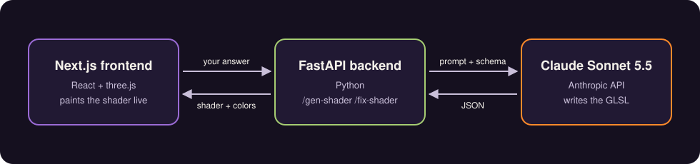
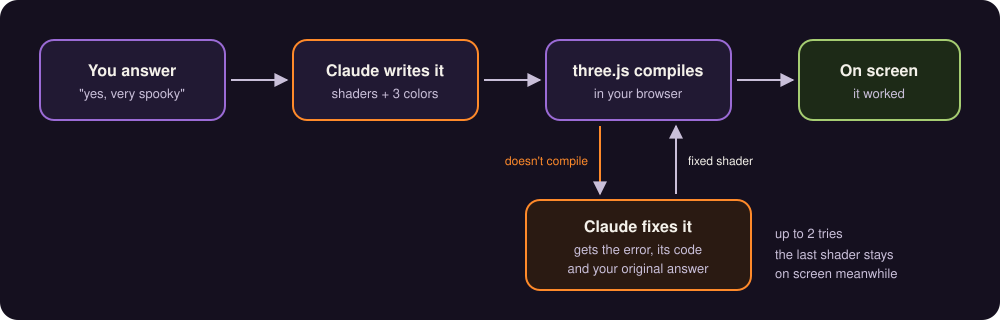

# gen-ai-visual-mood-project

**Tell it how you feel. Get a shader nobody's seen before.**

Type a feeling and Claude writes a brand-new animated GLSL shader for it, then paints it live behind a spinning black-and-white mirror of your webcam. Every answer gets its own one-off visual.


Right now it's in spooky mode 🎃. It asks *"are you feeling spooky?"*: say yes and it goes full Halloween, say no and you get something calm and cozy.

## How it works



Your answer goes to a small FastAPI server, which asks Claude Sonnet 5.5 for a vertex shader, a fragment shader and three colors. A JSON schema keeps the reply clean, so it always parses. three.js compiles it and it becomes the background.

### When a shader breaks



LLMs still write GLSL that doesn't compile now and then. When that happens, the last good shader stays up, and Claude gets a "hey, this doesn't work" with the compiler error, its own code and your original answer. It gets two tries.

## Run it

You need Node, Python 3.11+ and an [Anthropic API key](https://platform.claude.com/).

```bash
npm install
npm run dev
```

In a second terminal:

```bash
cd fastapi
python3 -m venv .venv
.venv/bin/pip install -r requirements.txt
echo "ANTHROPIC_API_KEY=your-key" >> .env
.venv/bin/uvicorn app:app --port=8000 --reload
```

Open [localhost:3000](http://localhost:3000) and allow the camera.

## Up next

Generated portraits that react to your mood, and reading the mood from your face instead of asking.
